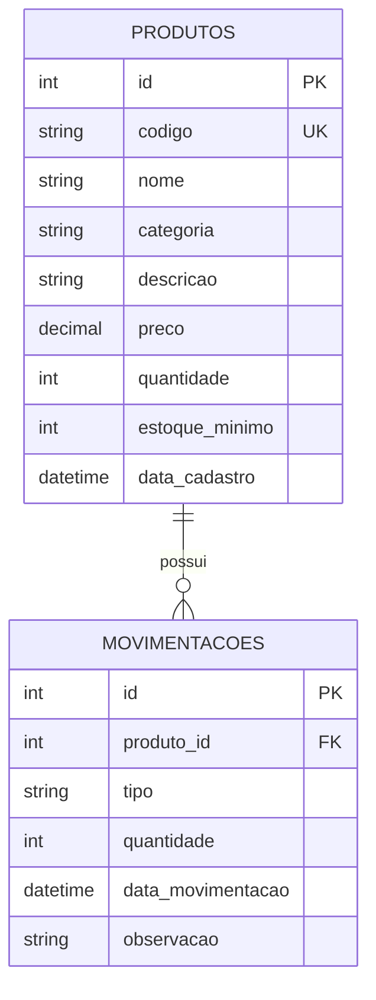

# 📦 Sistema de Controle de Estoque


Sistema web para controle de estoque, com cadastro de produtos, entradas e saídas, histórico de movimentações, dashboard com gráficos e relatórios exportáveis em CSV.

---

## 📌 Sobre o projeto

Este projeto simula o sistema interno de uma empresa para controlar o estoque de produtos. Ele responde a perguntas do dia a dia: *quanto tenho de cada produto? o que entrou e saiu? o que está acabando?*

**Objetivo:** praticar o desenvolvimento de uma aplicação web completa, do banco de dados até a interface, aplicando regras de negócio reais, validações, segurança básica e organização de código.

---

## ✨ Funcionalidades

**Produtos**
- Cadastro, listagem, edição e exclusão de produtos
- Pesquisa por código, nome ou categoria
- Página de detalhes com as últimas movimentações do produto
- Status automático: `ESTOQUE NORMAL` ou `ESTOQUE BAIXO`
- Confirmação antes de excluir

**Movimentações**
- Entrada de estoque, com prévia do novo saldo antes de confirmar
- Saída de estoque, bloqueada quando a quantidade é insuficiente
- Histórico completo com filtros por tipo, produto e período
- Data e hora registradas automaticamente pelo banco

**Dashboard**
- Cards: total de produtos, itens em estoque, produtos com estoque baixo, total de entradas e de saídas
- Gráfico de entradas x saídas
- Gráfico dos produtos com menor estoque (comparados ao estoque mínimo)
- Aviso quando existem produtos com estoque baixo

**Relatórios**
- Filtro por período (padrão: últimos 30 dias)
- Gráfico de movimentações por dia e de estoque por categoria
- Tabelas de produtos cadastrados, produtos com estoque baixo e movimentações do período
- Exportação de cada relatório para **CSV** (compatível com o Excel em português)

**Interface**
- Layout de sistema empresarial, com menu lateral e página atual destacada
- Responsivo: funciona em computador e celular
- Alertas que fecham sozinhos e proteção contra clique duplo nos formulários

---

## 🧠 Regras de negócio

- Um produto está com **estoque baixo** quando `quantidade <= estoque mínimo`.
- O estoque **nunca fica negativo**. A proteção acontece em quatro camadas: aviso na tela (JavaScript), verificação no servidor (Python), condição no `UPDATE` (SQL) e `CHECK` no banco.
- A quantidade de um produto **só muda por entrada ou saída**, e não pela edição. Assim, todo saldo tem um registro no histórico.
- A quantidade inicial informada no cadastro é registrada como uma **entrada** com a observação "Estoque inicial".
- Cada movimentação atualiza o estoque e grava o histórico **na mesma transação**: ou as duas operações acontecem, ou nenhuma.
- Produtos com movimentações **não podem ser excluídos**, para preservar o histórico (chave estrangeira).

---

## 🛠️ Tecnologias

| Camada | Tecnologia |
|---|---|
| Frontend | HTML5, CSS3 (Grid, Flexbox, variáveis CSS), JavaScript |
| Backend | Python, Flask (Blueprints e templates Jinja2), python-dotenv |
| Banco de dados | SQL Server (acesso com `pyodbc`) |
| Gráficos | Chart.js (via CDN) |
| Ferramentas | Visual Studio Code, Git, GitHub, SQL Server Management Studio |

---

## 🗂️ Estrutura do projeto

```
sistema-estoque/
│
├── app.py                    # Inicia o Flask, registra as rotas e monta o dashboard
├── config.py                 # Configurações (lidas do arquivo .env)
├── db.py                     # Função que abre a conexão com o SQL Server
├── requirements.txt          # Bibliotecas Python do projeto
├── teste_paginas.py          # Teste automático das páginas
├── README.md
├── LICENSE
├── .gitignore
├── .env.example              # Modelo de configuração (copie para .env)
│
├── database/
│   └── banco.sql             # Criação do banco, tabelas e dados de exemplo
│
├── routes/
│   ├── __init__.py
│   ├── produtos.py           # Cadastro, listagem, edição, exclusão e detalhes
│   ├── movimentacoes.py      # Entrada, saída e histórico
│   └── relatorios.py         # Relatórios e exportação CSV
│
├── templates/
│   ├── base.html             # Layout comum (menu lateral e alertas)
│   ├── index.html            # Dashboard
│   ├── produtos.html
│   ├── produto_form.html     # Usado no cadastro e na edição
│   ├── produto_detalhes.html
│   ├── entrada.html
│   ├── saida.html
│   ├── movimentacoes.html    # Histórico
│   ├── relatorios.html
│   └── erro.html             # Páginas de erro (404 e 500)
│
├── static/
│   ├── css/
│   │   └── style.css
│   └── js/
│       └── script.js
│
└── docs/
    └── screenshots/          # Imagens usadas neste README
```

---

## 🗃️ Modelo do banco de dados

Banco `SistemaEstoque`, com duas tabelas ligadas por chave estrangeira (um produto tem várias movimentações).



Restrições principais: `codigo` único, `quantidade >= 0`, `preco >= 0`, `tipo` somente `ENTRADA` ou `SAIDA` e quantidade da movimentação maior que zero.

---

## 🚀 Como instalar e executar

### Pré-requisitos

- [Python 3.10 ou superior](https://www.python.org/downloads/) (marque **Add python.exe to PATH** na instalação)
- SQL Server (a edição **Express** é gratuita) e o **SQL Server Management Studio (SSMS)**
- **ODBC Driver 17 for SQL Server** (ou 18, veja a observação abaixo)
- Git
- Windows, pois a conexão usa a **Autenticação do Windows**

### 1. Baixar o projeto

```powershell
git clone https://github.com/HenriqueJobskkj/sistema-estoque.git
cd sistema-estoque
```

### 2. Criar o ambiente virtual (recomendado)

```powershell
python -m venv venv
venv\Scripts\Activate.ps1
```

Se o PowerShell bloquear a execução de scripts, rode uma vez:

```powershell
Set-ExecutionPolicy -Scope CurrentUser -ExecutionPolicy RemoteSigned
```

### 3. Instalar as dependências

```powershell
python -m pip install -r requirements.txt
```

### 4. Configurar o banco de dados

1. Abra o **SSMS** e conecte ao seu servidor SQL Server.
2. Abra o arquivo `database/banco.sql` (**Arquivo → Abrir → Arquivo**).
3. Clique em **Executar** (ou aperte `F5`).

O script cria o banco `SistemaEstoque`, as tabelas e **8 produtos de exemplo com movimentações**. Ele pode ser executado mais de uma vez sem duplicar os dados.

### 5. Configurar a conexão

Crie o seu arquivo de configuração a partir do modelo:

```powershell
Copy-Item .env.example .env
```

Abra o `.env` e ajuste o `DB_SERVIDOR` para o nome do seu servidor (o mesmo que você digita no SSMS ao conectar, por exemplo `.\SQLEXPRESS`). O arquivo `.env` fica só no seu computador e **não vai para o GitHub**.

Variáveis disponíveis:

| Variável | Descrição | Padrão |
|---|---|---|
| `DB_SERVIDOR` | Nome do servidor SQL Server | `localhost` |
| `DB_BANCO` | Nome do banco de dados | `SistemaEstoque` |
| `DB_DRIVER` | Driver ODBC instalado | `ODBC Driver 17 for SQL Server` |
| `SECRET_KEY` | Chave do Flask para as mensagens da tela | `chave-de-desenvolvimento` |
| `FLASK_DEBUG` | Modo debug (`1` ligado, `0` desligado) | `1` |

> Se você usa o **ODBC Driver 18**, altere o `DB_DRIVER` no `.env`. Para ver os drivers instalados:
> `python -c "import pyodbc; print(pyodbc.drivers())"`

### 6. Executar

```powershell
python app.py
```

Abra no navegador: **http://127.0.0.1:5000**

### Problemas comuns

| Problema | Solução |
|---|---|
| `pip` não é reconhecido | Use `python -m pip install ...` |
| `Login timeout expired` ou erro de servidor | O nome do servidor está errado. Confira o `DB_SERVIDOR` no `.env` |
| `Data source name not found` | O driver ODBC não está instalado ou tem outro nome. Ajuste o `DB_DRIVER` |
| Os gráficos não aparecem | O Chart.js é carregado pela internet. Confira a conexão |

---

## 🧪 Testes

**Teste automático:** abre todas as páginas e confere os códigos de resposta. Ele só faz consultas e não altera o banco.

```powershell
python teste_paginas.py
```

**Testes manuais:** o roteiro cobre cadastro, edição, exclusão, entradas, saídas (incluindo quantidade insuficiente, estoque zerado e clique duplo), filtros, relatórios, exportação CSV e tentativas de ataque.

---

## 🔒 Segurança e boas práticas

- **SQL Injection:** todas as consultas usam parâmetros (`?`). Os filtros dinâmicos montam só trechos fixos de SQL, e os valores digitados sempre vão como parâmetros.
- **XSS:** o Jinja2 escapa automaticamente os textos exibidos nas páginas.
- **Injeção de fórmulas no CSV:** textos iniciados por `=`, `+`, `-` ou `@` recebem um apóstrofo na exportação.
- **Validação em três níveis:** navegador (`required`, `min`), servidor (Python) e banco (`CHECK`, `UNIQUE`, chave estrangeira).
- **Transações:** o estoque e o histórico nunca ficam inconsistentes.
- **Exclusão via POST:** nunca por link (GET), com confirmação no navegador.
- **Tratamento de erros:** falhas do banco geram mensagens amigáveis, a conexão é sempre fechada e existem páginas de erro 404 e 500.
- **Configuração fora do código:** servidor, banco, driver e chave ficam no arquivo `.env`, que é ignorado pelo Git.

---

## 🖼️ Imagens do projeto

> Adicione os prints na pasta `docs/screenshots/` e troque cada espaço abaixo pela imagem.

### Dashboard
*(espaço para o print do dashboard)*
<!--  -->

### Lista de produtos
*(espaço para o print da lista de produtos)*
<!--  -->

### Cadastro de produto
*(espaço para o print do formulário)*
<!--  -->

### Entrada e saída de estoque
*(espaço para o print da entrada ou da saída)*
<!--  -->

### Histórico de movimentações
*(espaço para o print do histórico)*
<!--  -->

### Relatórios
*(espaço para o print dos relatórios)*
<!--  -->

### Versão para celular
*(espaço para o print no modo celular)*
<!--  -->

---

## 🔮 Melhorias futuras

- Login de usuários, com perfis (administrador e operador) e registro de quem fez cada movimentação
- Inativar produtos em vez de bloquear a exclusão quando há histórico
- Paginação nas tabelas
- Tabela própria de categorias, fornecedores e clientes
- Código de barras e leitura por câmera
- Exportação dos relatórios em PDF e importação de produtos por CSV
- Testes automatizados também para os formulários (com um banco de teste separado)
- Container Docker e publicação online
- Alertas de estoque baixo por e-mail
- Modo escuro
- API REST para integração com outros sistemas

---

## 📄 Licença

Distribuído sob a licença MIT. Veja o arquivo [LICENSE](LICENSE) para mais informações.

---

## 👤 Autor

**Henrique Jobstraibizer**

- GitHub: [github.com/HenriqueJobskkj](https://github.com/HenriqueJobskkj)
- LinkedIn: [linkedin.com/in/henrique-jobstraibizer](https://linkedin.com/in/henrique-jobstraibizer)
- E-mail: rickjob123@gmail.com